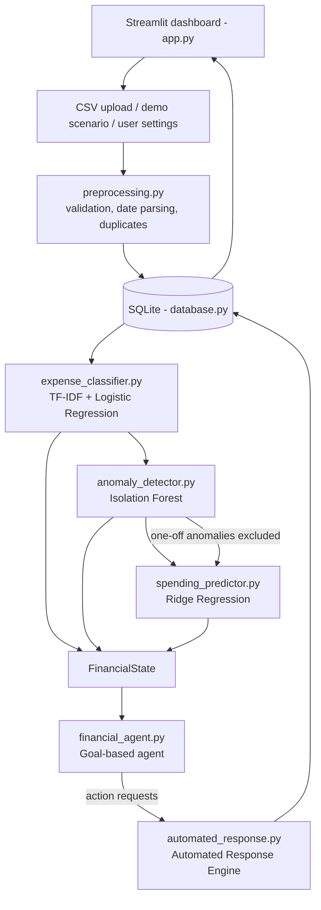

# FinGuard AI
**Intelligent Personal Finance Management and Budget Optimization Agent**

A locally-running AI system that categorises bank transactions, detects unusual spending, forecasts next month's expenses and uses a **goal-based intelligent agent** to plan a budget that meets the user's savings goal. An **automated response engine** then saves alerts, budget proposals and review flags to SQLite.

**Faculty AI combination (No. 10): Anomaly Detection + Intelligent Agent + Automated Response.**
Supporting ML: TF-IDF + Logistic Regression (categorisation) and Ridge Regression (forecasting).

> All data in this repository is **synthetic** (generated by `scripts/generate_dataset.py`). The metrics show that the pipeline works as designed; they do not prove accuracy on real bank statements. No paid APIs, no API keys, no GPU, no bank connection. No money is ever moved.

---

## 1. Quick start (Windows + VS Code)

Open the `finguard-ai` folder in VS Code → **Terminal → New Terminal** (PowerShell), then:

```powershell
# 1. create and activate a virtual environment (Python 3.11 or newer)
python -m venv .venv
.venv\Scripts\Activate.ps1
#   if PowerShell blocks the script:  Set-ExecutionPolicy -Scope CurrentUser RemoteSigned
#   (Command Prompt instead:          .venv\Scripts\activate.bat)

# 2. install dependencies
pip install -r requirements.txt

# 3. generate the synthetic datasets  (~10 s)
python scripts/generate_dataset.py

# 4. train and save the three models   (~1 min)
python scripts/train_models.py

# 5. evaluate everything and write reports/evaluation_report.md   (~1-2 min)
python scripts/evaluate_models.py

# 6. run the automated tests
python -m pytest -v

# 7. start the dashboard  -> opens http://localhost:8501
streamlit run app.py
```

macOS / Linux: identical, except activate with `source .venv/bin/activate`.

Steps 3–5 are already done in the delivered folder (CSV files, `models/*.joblib`, `reports/`), but re-running them is recommended after installing, because scikit-learn model files should be created by the same scikit-learn version that loads them. If the models are missing or cannot be loaded, the app trains them automatically on first start.

**Optional React frontend.** A second UI (React + FastAPI) shows the same results. It needs Node.js 18+ and two terminals; see [frontend/README.md](frontend/README.md). The Streamlit app above remains the main demo.

## 2. Demo walkthrough (about 5 minutes)

1. `streamlit run app.py` → sidebar **📤 Upload Transactions**.
2. Click **Load scenario** on a card. Each card resets the database, imports a CSV from `data/` and runs the whole pipeline. Only the CSV file and the user settings are predefined; every output is computed live.

| Scenario | Input | What the pipeline computes (actual output of this build) |
|---|---|---|
| 1. Normal spending | `demo_normal.csv`, goal ₹10,000 | Income detected ₹56,127 · forecast for 2026-10 **₹41,245** (Ridge) · limit ₹46,127 → **ON_TRACK** · 0 unusual · actions: savings recommendation + budget proposal |
| 2. Unusual transactions | `demo_anomaly.csv` (same history + ₹6,800 food and ₹38,500 electronics in Sep) | Isolation Forest flags both (18.5× and 20.6× typical) · they are excluded from the forecast inputs, so the forecast stays ₹41,245 → next month **ON_TRACK**, but September is **over the limit** · actions: 2 HIGH "unusual transaction" alerts, 1 "month over budget" alert, 2 review flags |
| 3. Overspending, achievable goal | `demo_overspending.csv`, income ₹30,000, goal ₹7,000 | Forecast ₹23,927 vs limit ₹23,000 → **ACHIEVABLE_WITH_CUTS** · agent cuts Shopping by ₹927 (discretionary, grew 75%) · actions: overspending alert, budget proposal, reduction recommendation |
| 4. Unrealistic goal | same data, goal ₹15,000 | Needs ₹8,927 of cuts, at most ₹5,316 possible without touching essentials → **INFEASIBLE** · agent proposes maximum feasible cuts and recommends a realistic goal of ≈₹11,389 instead of a fake plan |

3. Visit the other pages:
   - **🏠 Home** – six KPI cards, trend, category chart, forecast, savings gauge, alerts.
   - **🏷️ Expense Classification** – model-predicted categories with confidence; correct a category → whole pipeline re-runs.
   - **🚨 Anomaly Detection** – scatter plot, anomaly scores, explanations; **Confirm as legitimate** → the related alert is auto-resolved on the next run.
   - **📈 Spending Prediction** – actual vs predicted chart, method label (ML or rule-based fallback).
   - **🤖 AI Financial Advisor** – change income / goal / essentials and watch the agent's perceive → evaluate → plan → act cycle.
   - **🔔 Alerts and Reports** – alerts (acknowledge), budget proposals (accept), recommendations, full action log, report download.
4. To show the "infeasible" behaviour live: in scenario 3 open **AI Financial Advisor**, set the goal to 15000 and press **Save and run the agent**. The overspending alert is resolved automatically and a "goal infeasible" alert appears.

Upload your own file: **Upload Transactions → Option B**. Required columns: `Date, Description, Amount, Type`; optional `Transaction ID, Category`. `data/sample_transactions.csv` is a small example that deliberately contains a duplicate, a bad date and a bad amount, which shows the validator working.

Tip: `http://localhost:8501/?page=6` opens a page directly (1 = Home … 7 = Alerts).

## 3. Architecture



More diagrams (integration sequence, database schema): [docs/architecture.md](docs/architecture.md).

## 4. Results (from `reports/evaluation_report.md`, synthetic data)

| Component | Method | Result | Baseline |
|---|---|---|---|
| Categorisation (unseen merchants) | TF-IDF + LogReg | Accuracy **0.747**, macro-F1 **0.715** | Keyword rules: 0.659 / 0.688 |
| Anomaly detection (held-out months) | Isolation Forest | P **0.81**, R **0.63**, F1 **0.71** | Rule "> 3× typical": P 0.30, R 0.98, F1 0.45 |
| Forecast (12 held-out months × 6 profiles) | Ridge Regression | MAE **₹6,539** (13.3%) | Historical mean ₹6,574 · 3-month average ₹6,810 |
| Agent (500 random cases) | Goal-based rules | 7/7 constraint checks pass in 500/500 cases | – |

Honest reading: the classifier clearly beats keyword rules, and Isolation Forest gives far fewer false alerts than the simple rule. Ridge is **only marginally** better than the historical-average baseline, because month-to-month spending on this data is mostly random. See [docs/ml_explanation.md](docs/ml_explanation.md).

## 5. Project structure

```
finguard-ai/
├── app.py                      Streamlit dashboard (7 pages)
├── requirements.txt / pytest.ini / .streamlit/config.toml
├── data/
│   ├── sample_transactions.csv     small messy upload example
│   ├── demo_normal.csv / demo_anomaly.csv / demo_overspending.csv
│   └── generated/                  training + test datasets, dataset_summary.json
├── models/                     saved .joblib models + training_info.json
├── reports/                    evaluation_report.md, metrics.json, confusion matrices, forecast predictions
├── src/
│   ├── config.py               paths, categories, agent constants
│   ├── utils.py                ₹ formatting, hashing
│   ├── preprocessing.py        CSV validation & cleaning           (Member 3)
│   ├── data_generator.py       synthetic data generator            (Member 3)
│   ├── database.py             SQLite schema & queries             (Member 4)
│   ├── expense_classifier.py   TF-IDF + LogReg, keyword baseline   (Member 2)
│   ├── anomaly_detector.py     Isolation Forest + explanations     (Member 2)
│   ├── spending_predictor.py   Ridge forecaster + baselines        (Member 2)
│   ├── financial_agent.py      FinancialDecisionAgent              (Member 2)
│   ├── automated_response.py   AutomatedResponseEngine             (Member 4)
│   ├── training.py             training / model loading
│   ├── pipeline.py             end-to-end orchestration + demo scenarios (Member 4)
│   ├── charts.py               Plotly charts                       (Member 4)
│   └── reports.py              Markdown / CSV export               (Member 4)
├── scripts/  generate_dataset.py · train_models.py · evaluate_models.py
├── tests/    55 pytest tests (preprocessing, ML, agent, response, integration, app start-up, API)
└── docs/     architecture, workflow, ML explanation, literature survey, data dictionary,
              team contributions, Review 1/2/3 content, user manual, viva Q&A, poster, screenshots/
```

## 6. Tests

`python -m pytest -v` → **55 passed** (verified on Linux, Python 3.12). Without the optional API packages from `requirements-api.txt`, `tests/test_api.py` is skipped (pytest reports 48 passed, 1 skipped). The 13 required scenarios map to tests as follows:

| # | Requirement | Test(s) |
|---|---|---|
| 1 | Valid CSV upload | `test_preprocessing::test_valid_csv_is_accepted`, `test_mixed_formats_are_parsed` |
| 2 | Missing columns | `test_missing_required_columns_is_rejected` |
| 3 | Duplicates | `test_duplicates_inside_file_are_removed`, `test_duplicates_against_database_are_skipped` |
| 4 | Category prediction | `test_ml_pipeline::test_classifier_predicts_obvious_categories`, `test_blank_categories_are_filled_and_user_labels_kept` |
| 5 | Unusual transaction | `test_large_transaction_is_flagged_with_explanation` |
| 6 | Forecast | `test_ml_forecast_with_enough_history`, `test_rule_based_fallback_with_short_history` |
| 7 | Achievable goal | `test_agent::test_achievable_goal_closes_the_gap` |
| 8 | Infeasible goal | `test_infeasible_goal_is_detected_not_faked` |
| 9 | Agent actions | `test_actions_for_achievable_case`, `test_anomaly_influences_decision` |
| 10 | Alert persistence | `test_automated_response::test_alert_is_created_and_persisted` |
| 11 | Duplicate alerts | `test_duplicate_alert_is_not_created` |
| 12 | Budget proposal | `test_budget_proposal_is_saved_once_and_superseded_on_change` |
| 13 | Startup + end-to-end | `test_integration::test_streamlit_app_starts_and_all_pages_render`, `test_demo_scenarios_produce_different_decisions` |

The tests were run on Linux; please re-run them once on your Windows laptops before the review.

## 7. Documentation index

| Document | Purpose |
|---|---|
| [docs/architecture.md](docs/architecture.md) | Architecture, integration sequence and database diagrams |
| [docs/workflow.md](docs/workflow.md) | The 12 workflow steps mapped to code |
| [docs/ml_explanation.md](docs/ml_explanation.md) | Algorithms, features, design decisions, agent PEAS, limitations |
| [docs/data_dictionary.md](docs/data_dictionary.md) | CSV format, datasets, DB tables, data observations |
| [docs/literature_survey.md](docs/literature_survey.md) | Literature survey framework with verifiable references |
| [docs/team_contributions.md](docs/team_contributions.md) | Five-member responsibilities and integration plan |
| [docs/review1_content.md](docs/review1_content.md) · [review2](docs/review2_content.md) · [review3](docs/review3_content.md) | Review presentations |
| [docs/user_manual.md](docs/user_manual.md) · [docs/viva_questions.md](docs/viva_questions.md) · [docs/poster_content.md](docs/poster_content.md) | Manual, viva preparation, poster |
