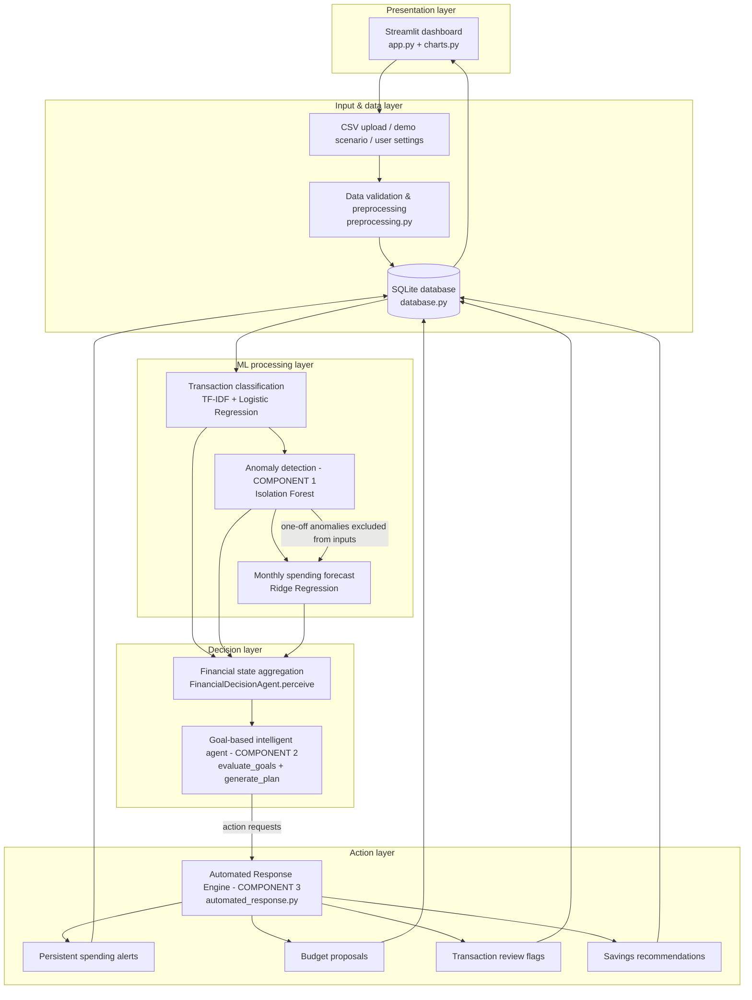
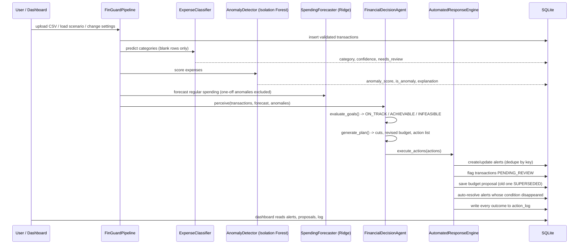
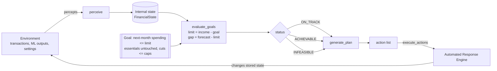
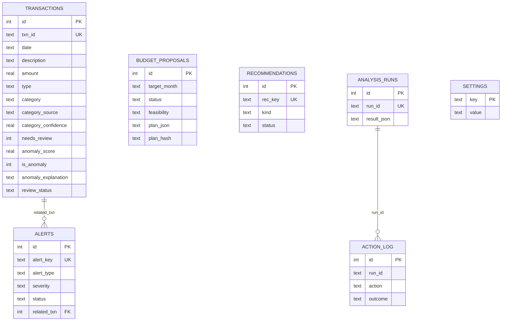

# System Architecture

All diagrams are Mermaid (render on GitHub, in VS Code with the "Markdown Preview Mermaid Support" extension, or at https://mermaid.live).

## 1. Layered architecture

`src/pipeline.py` (`FinGuardPipeline.run_analysis`) executes these layers in this exact order. The dashboard, the demo scenarios and the integration tests all call the same method.

## 2. Integration of the three AI components (one run)

### Concrete example (demo scenario 2)
1. A ₹38,500 "POS CROMA ELECTRONICS" expense is inserted.
2. Isolation Forest gives it the highest anomaly score (0.109) and flags it; the statistics module explains: *"20.6× the typical amount (₹1,869)"*.
3. The forecaster drops it from the inputs (one-off), so next month's forecast is not inflated.
4. The agent perceives it as a high-side anomaly in the current month: ₹38,500 ≥ 10 % of income → **HIGH** severity. It also sees that September spending (₹89,792) exceeds the limit (₹46,127), mostly because of unusual transactions.
5. The agent requests `FLAG_TRANSACTION`, `CREATE_ALERT(UNUSUAL_TRANSACTION)` and `CREATE_ALERT(CURRENT_MONTH_OVER_BUDGET)`.
6. The response engine writes them to SQLite. A second run produces `UNCHANGED` (no duplicates).
7. The user clicks **Confirm as legitimate** → next run: the agent no longer requests the alert → the engine resolves it automatically.

## 3. Agent architecture (goal-based)

## 4. Database schema

## 5. Module responsibilities

| Module | Responsibility | Key functions / classes |
|---|---|---|
| `preprocessing.py` | Validate & clean CSV, monthly totals | `load_csv`, `validate_transactions`, `clean_description` |
| `database.py` | SQLite schema and all queries | `FinanceDB` |
| `expense_classifier.py` | Categorisation + keyword baseline | `ExpenseClassifier`, `KeywordBaselineClassifier` |
| `anomaly_detector.py` | Isolation Forest + statistical explanations | `AnomalyDetector`, `high_side_anomalies` |
| `spending_predictor.py` | Ridge forecast + baselines + fallback | `SpendingForecaster`, `make_lag_features` |
| `financial_agent.py` | Goal-based agent | `FinancialDecisionAgent.perceive / evaluate_goals / generate_plan / execute_actions` |
| `automated_response.py` | Executes and persists actions, auto-resolves | `AutomatedResponseEngine.execute` |
| `pipeline.py` | Orchestration, demo scenarios | `FinGuardPipeline.run_analysis`, `DEMO_SCENARIOS` |
| `training.py` | Training, contamination selection, model loading | `train_all`, `load_models` |
| `reports.py`, `charts.py` | Export, visualisation | `markdown_report`, chart builders |

## 6. Hardware / software requirements
- Any laptop with 4 GB RAM and a dual-core CPU; ~400 MB disk for the virtual environment. No GPU.
- Python 3.11+, Windows 10/11, macOS or Linux. Runs fully offline after `pip install`.
- Training all models takes about a minute; one analysis run on a few hundred transactions takes about a second.
