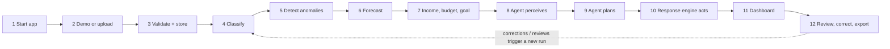

# Complete Workflow (12 steps → code)

| Step | What happens | Where in the code |
|---|---|---|
| 1 | User runs `streamlit run app.py`; models are loaded once (trained automatically if missing). | `app.py:get_pipeline`, `src/training.py:load_models` |
| 2 | User loads a demo scenario or uploads a CSV. | `app.py` page *Upload Transactions*; `FinGuardPipeline.load_demo / import_csv` |
| 3 | Column mapping, date/amount parsing, type normalisation, invalid-row removal, duplicate detection (inside file and against DB), storage. | `preprocessing.validate_transactions`, `FinanceDB.insert_transactions` |
| 4 | ML predicts a category for every expense without a user label; confidence < 0.60 → `needs_review`. | `FinGuardPipeline.classify`, `ExpenseClassifier.predict` |
| 5 | Isolation Forest scores every expense; explanations built from category statistics. | `AnomalyDetector.detect` |
| 6 | Ridge forecasts next month's regular spending (rule-based fallback if < 3 complete months). | `SpendingForecaster.forecast` |
| 7 | User sets income (or auto-detect), monthly cap, savings goal, essential categories. | `app.py` page *AI Financial Advisor*; `settings` table |
| 8 | Agent builds `FinancialState` from all of the above. | `FinancialDecisionAgent.perceive` |
| 9 | Agent evaluates the goal, searches over discretionary cuts, builds a revised budget and an action list. | `evaluate_goals`, `generate_plan`, `_decide_actions` |
| 10 | Engine executes actions in SQLite with deduplication and auto-resolution; every outcome is logged. | `AutomatedResponseEngine.execute` |
| 11 | Dashboard shows KPIs, charts, alerts, plan. | `app.py` all pages, `src/charts.py` |
| 12 | User corrects categories, confirms anomalies, acknowledges alerts, accepts proposals, downloads the report. Each correction or review triggers a new run. | `FinanceDB.correct_category / set_review_status`, `reports.markdown_report` |

## Expected demo outputs

These values come from running this build (seeded data, deterministic models). If you regenerate the data with another seed they will change, and that is expected.

| Scenario | Forecast | Limit | Agent status | Main actions |
|---|---|---|---|---|
| 1 Normal | ₹41,245 | ₹46,127 | ON_TRACK | Savings recommendation, budget proposal |
| 2 Unusual transactions | ₹41,245 (2 one-offs worth ₹45,300 excluded) | ₹46,127 | ON_TRACK (next month); September over limit | 2 HIGH unusual-transaction alerts, month-over-budget alert, 2 review flags |
| 3 Overspending | ₹23,927 | ₹23,000 | ACHIEVABLE_WITH_CUTS | Overspending alert, Shopping −₹927, budget proposal |
| 4 Unrealistic goal (₹15,000) | ₹23,927 | ₹15,000 | INFEASIBLE | Goal-infeasible alert, realistic goal ≈₹11,389, maximum-cut proposal |

Re-running the analysis without changing anything gives only `UNCHANGED` outcomes in the action log. This is how duplicate prevention shows up in practice.
